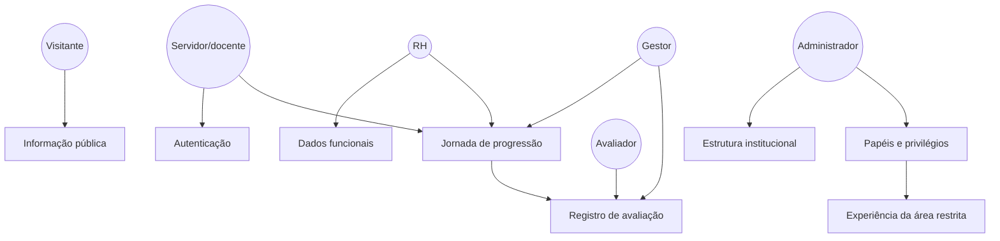
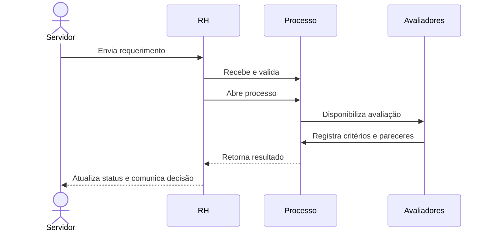
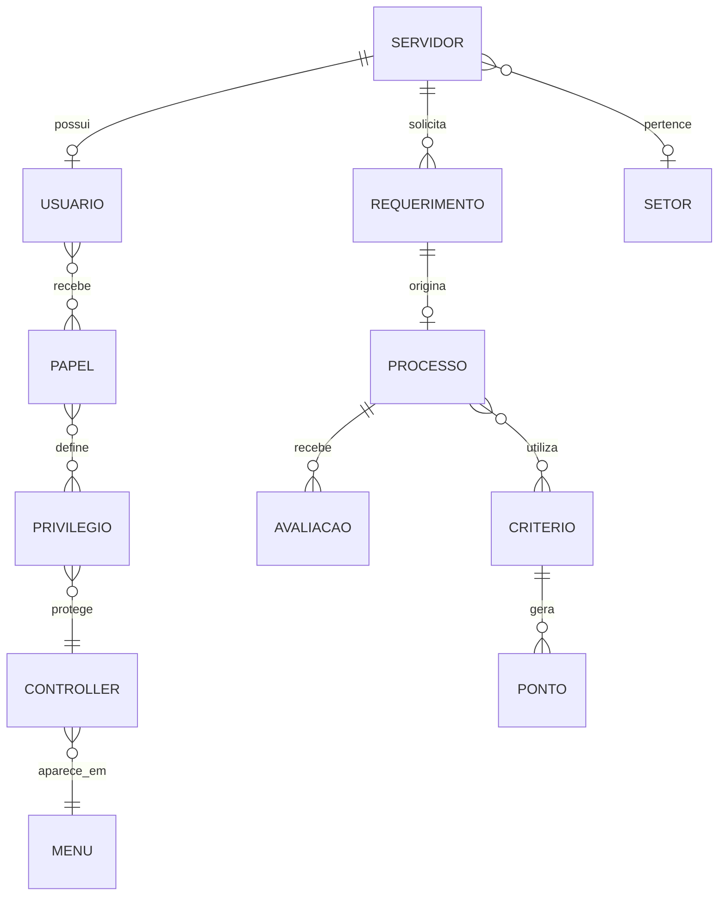

# Visão de produto: domínios, atores e jornadas

## Visão do produto

O NeoCPPD deve funcionar como a porta de entrada e o espaço de trabalho da política de pessoal docente. O visitante encontra a informação; o servidor entende sua situação; o RH conduz o processo; os avaliadores registram evidências; e a administração mantém a estrutura e as permissões.

O valor do sistema está na continuidade entre essas etapas. Uma solicitação deve ter contexto, responsável, status, evidências e uma conclusão acompanhável pelo servidor.

## Domínios de produto

| Domínio | Pergunta que responde | Atores | Entidades |
|---|---|---|---|
| Informação pública | Onde encontro regras e documentos? | Visitante, servidor | Documento, normativa, serviço |
| Identidade | Quem sou e o que posso acessar? | Usuários autenticados | Servidor, usuário, sessão |
| Estrutura institucional | Em qual unidade o trabalho acontece? | Administrador, RH | Campus, curso, setor |
| Carreira docente | Qual é a situação funcional? | Servidor, RH, gestor | Carreira, classe, nível, titulação |
| Progressão | Em que etapa está a solicitação? | Servidor, RH, gestor | Requerimento, processo, status |
| Avaliação | Quais evidências sustentam a decisão? | Avaliador, gestor | Critério, ponto, avaliação |
| Governança de acesso | Quem pode realizar cada ação? | Administrador | Papel, privilégio, menu |

## Modelo de atores

## Jornada do servidor

| Etapa | Objetivo | Necessidade de produto |
|---|---|---|
| Descoberta | Entender regras e serviços. | Conteúdo público atualizado. |
| Entrada | Acessar a área restrita. | Login simples e mensagens claras. |
| Preparação | Conferir dados funcionais. | Perfil confiável e completo. |
| Solicitação | Iniciar ou acompanhar progressão. | Formulário orientado e status compreensível. |
| Acompanhamento | Saber responsável e próximo passo. | Linha do tempo e notificações. |
| Resultado | Consultar decisão e fundamentos. | Histórico e resultado transparente. |

## Jornada operacional do RH

## Relação entre entidades

## Casos de uso prioritários

### Consultar informação pública

O visitante acessa o portal e encontra documentos, normas, tabelas e explicações sobre os serviços da CPPD sem autenticação.

### Acessar o espaço de trabalho

O servidor autentica-se por senha ou Google. O sistema valida seu vínculo, carrega seus papéis e apresenta os menus correspondentes.

### Solicitar progressão

O servidor consulta seus dados, inicia um requerimento e acompanha a evolução. O RH recebe a solicitação, altera seu estado e abre o processo quando a documentação está pronta.

### Avaliar um processo

O avaliador acessa os processos atribuídos, preenche critérios e pontos e registra sua avaliação. O gestor e o RH usam essas informações para concluir a análise.

### Administrar o sistema

O administrador mantém campi, cursos, usuários, papéis, privilégios e menus. Essas configurações determinam a experiência e o alcance de cada perfil.

## Oportunidades de evolução

1. Transformar status técnicos em uma linha do tempo orientada ao servidor.
2. Adicionar notificações por etapa e prazo.
3. Registrar histórico de alterações e responsável por cada decisão.
4. Criar painéis de acompanhamento para RH e gestores.
5. Unificar os módulos legados antes de ampliar novos fluxos.
6. Formalizar o modelo de dados e os critérios de autorização.

## Premissas e limites

- Esta visão representa o produto desejado a partir do comportamento encontrado no código.
- O banco completo não está no repositório; algumas entidades foram inferidas das consultas.
- Existem controllers legados de CodeIgniter 3, o que pode interromper jornadas na versão atual.
- As oportunidades de evolução são recomendações de produto, não funcionalidades já implementadas.
