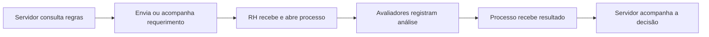

# Visão de produto e capacidades do sistema

## Propósito

O NeoCPPD é um sistema institucional para organizar a jornada de gestão da carreira docente: informar a comunidade, receber solicitações de progressão, conduzir avaliações e dar ao RH e à administração uma visão controlada dos processos.

## Usuários e necessidades

| Usuário | Necessidade | Resultado esperado |
|---|---|---|
| Visitante | Encontrar informações, documentos e normas. | Acesso rápido à informação pública. |
| Servidor/docente | Consultar sua situação e acompanhar progressão. | Clareza sobre status e próximos passos. |
| RH | Receber, analisar e encaminhar requerimentos. | Processos padronizados e rastreáveis. |
| Gestor | Consultar dados e acompanhar avaliações. | Decisões baseadas em dados. |
| Avaliador | Registrar critérios, pontos e avaliações. | Avaliação organizada e vinculada ao processo. |
| Administrador | Configurar estrutura, usuários e acessos. | Operação segura e adaptável. |

## Capacidades do produto

| Capacidade | Valor para o usuário | Evidência no produto |
|---|---|---|
| Portal institucional | Centraliza informações da CPPD. | Home, documentos, tabelas e normativas. |
| Acesso autenticado | Protege informações funcionais. | Login por senha, Google OAuth e sessão. |
| Navegação por papel | Mostra menus compatíveis com cada função. | Usuário, papel, privilégio, menu e controller. |
| Cadastro institucional | Mantém a estrutura administrativa. | Campi, cursos, vínculos, configurações e setores. |
| Cadastro funcional | Centraliza dados necessários à carreira. | Servidores, carreira, classe, nível e titulação. |
| Jornada de progressão | Organiza requerimento, processo e avaliação. | Status, requerimentos, processos, critérios e pontos. |
| Avaliação colaborativa | Registra avaliações de diferentes perspectivas. | Avaliações docente, discente e da chefia. |
| Operação administrativa | Acelera a manutenção de cadastros. | Grocery CRUD e relacionamentos. |

## Jornada principal

## Regras observadas

- A área restrita exige uma sessão com usuário autenticado.
- O login Google depende de um servidor previamente cadastrado pelo e-mail.
- A visibilidade do menu é calculada a partir de papéis e privilégios.
- Requerimentos possuem estados que orientam a próxima ação do RH ou da avaliação.

## O que precisa ser esclarecido

- Critérios oficiais de aprovação e reprovação.
- Responsável e prazo de cada etapa.
- Notificações para servidor, RH e avaliadores.
- Histórico e auditoria das mudanças de status.
- Indicadores de volume, tempo e processos pendentes.
- Fonte oficial do banco inicial e procedimento de recuperação.

## Indicadores recomendados

| Indicador | Pergunta de produto |
|---|---|
| Tempo médio do requerimento ao resultado | Onde a jornada está demorando? |
| Requerimentos por status | Quantos processos estão parados? |
| Processos concluídos no prazo | O serviço atende o compromisso institucional? |
| Usuários ativos por perfil | Quem usa o sistema e com que frequência? |
| Erros de login e acesso | Onde existem barreiras de entrada? |
