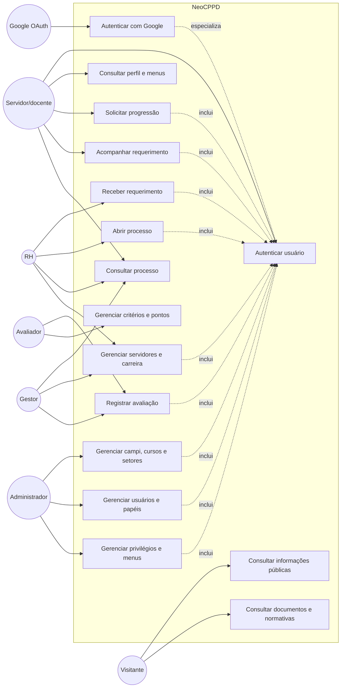

# Diagrama UML de casos de uso

Este diagrama representa os principais atores e casos de uso identificados no sistema NeoCPPD.

## Atores

| Ator | Papel no produto |
|---|---|
| Visitante | Consulta o conteúdo público da CPPD. |
| Servidor/docente | Acessa seu perfil, solicita progressão e acompanha processos. |
| RH | Recebe requerimentos, abre processos e mantém dados funcionais. |
| Gestor | Consulta processos e participa das avaliações e decisões. |
| Avaliador | Registra avaliações, critérios e pontuações. |
| Administrador | Mantém estrutura, usuários, papéis, privilégios e menus. |
| Google OAuth | Fornece a autenticação externa para o login Google. |

## Relações principais

- `Autenticar com Google` é uma variação de `Autenticar usuário`.
- Os casos de uso da área restrita dependem de autenticação.
- `Solicitar progressão` inicia a jornada que pode resultar em um processo.
- `Receber requerimento` pode levar à abertura de um processo.
- `Registrar avaliação` utiliza critérios e pontos.
- Os menus apresentados dependem dos papéis e privilégios do usuário.

## Observação

O diagrama descreve os casos de uso observados ou inferidos a partir do código. Ele não substitui uma especificação formal de requisitos e deve ser revisado com os responsáveis pelo processo da CPPD.
